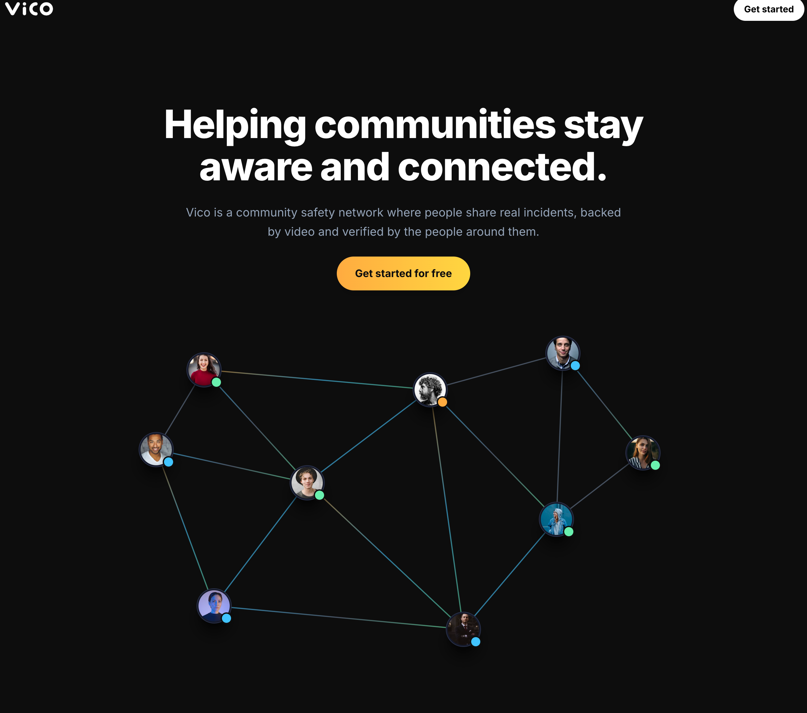
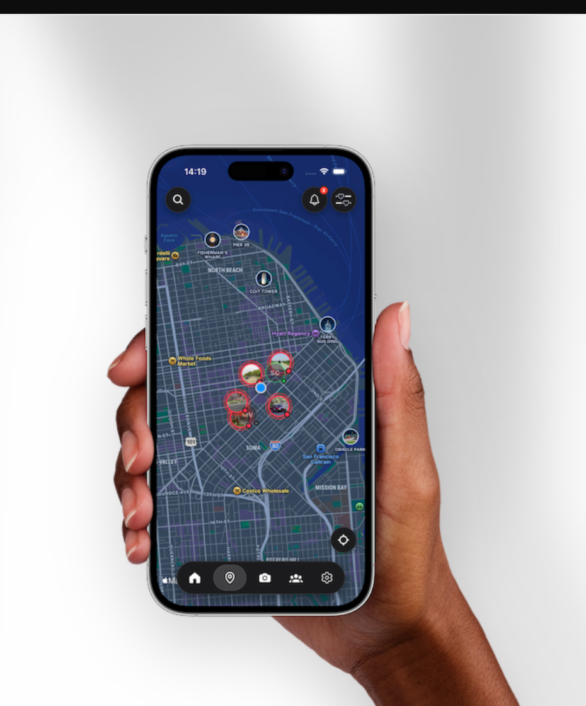
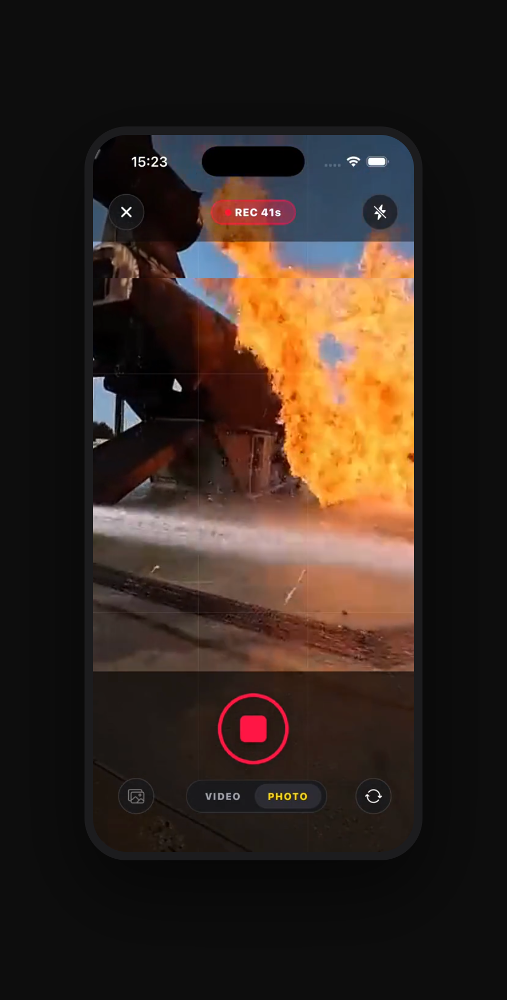
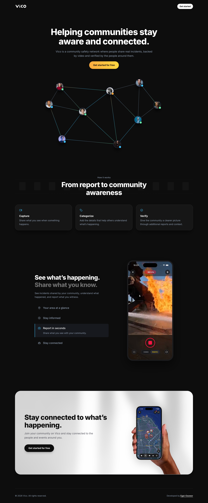

<div align="center">



# Vico

**Real-Time Hyperlocal Community Safety & Tactical Incident Radar**

[](https://docs.expo.dev/versions/v57.0.0/)
[](https://reactnative.dev/)
[](https://www.typescriptlang.org/)
[](https://firebase.google.com/)
[](https://github.com/pmndrs/zustand)
[](./LICENSE)

<p align="center">
  <a href="#overview">Overview</a> •
  <a href="#app-preview">App Preview</a> •
  <a href="#core-features">Core Features</a> •
  <a href="#architecture--tech-stack">Architecture</a> •
  <a href="#offline-first-sync-engine">Offline Sync</a> •
  <a href="#geohash-spatial-engine">Spatial Engine</a> •
  <a href="#getting-started">Getting Started</a> •
  <a href="#landing-page">Landing Page</a>
</p>

---

</div>

## Overview

**Vico** is an open, verified community safety network that keeps neighborhoods informed, vigilant, and connected. When an incident occurs, community members can broadcast real-time photo and video evidence in seconds. Every report is anchored to precision geohash sectors, vetted through crowd consensus, and automatically prioritized for residents within configurable safe zones.

With an **offline-first SQLite sync engine**, **client-side media compression**, **dynamic clustering**, and **private safety circles**, Vico delivers tactical-grade situational awareness even during degraded network connectivity.

---

## App Preview

<div align="center">
  <table>
    <tr>
      <td align="center" width="50%">
        
        <br />
        <b>📍 Tactical Threat Radar</b>
        <p><i>Live dark-mode map with cluster density, safe zone rings, and active incident markers.</i></p>
      </td>
      <td align="center" width="50%">
        
        <br />
        <b>📹 Instant Evidence Capture</b>
        <p><i>Zero-latency camera recording with real-time compression, category tagging, and location verification.</i></p>
      </td>
    </tr>
  </table>
</div>

---

## Core Pillars

<div align="center">
  <table>
    <tr>
      <td align="center" width="33%">
        
        <br />
        <b>Real-Time Radar</b>
        <p>Dynamic threat mapping with perimeter boundary tracking and sub-second breach alerts.</p>
      </td>
      <td align="center" width="33%">
        
        <br />
        <b>Trusted Circles</b>
        <p>Private micro-networks for family and neighbors with live statuses, mutual watch, and secure group chat.</p>
      </td>
      <td align="center" width="33%">
        
        <br />
        <b>Autonomous Safe Zones</b>
        <p>Configurable geofenced safety perimeters (0.5km – 10km) that trigger proactive push warnings.</p>
      </td>
    </tr>
  </table>
</div>

---

## Key Features

### 📍 Tactical Live Map & Spatial Clustering
- **Mapbox & React Native Maps Integration**: High-contrast tactical dark mode optimized for daytime clarity and night patrols.
- **Dynamic Cluster Markers**: Aggregates dense urban incidents into expandable cluster nodes with live counts.
- **Real-Time Viewport Subscriptions**: Firestore snapshot listeners dynamically fetch incidents only within active viewport bounds.
- **Search & POI Discovery**: Integrated forward geocoding and search modal for neighborhoods, landmarks, and addresses.

### 🎥 Incident Capture & Evidence Pipeline
- **Zero-Friction Camera**: Seamless toggle between high-res photography and 45-second compressed video evidence (`expo-camera`, `expo-video`).
- **Client-Side Compression**: Automatically downsamples and compresses media (`IMAGE_MAX_DIMENSION = 1920`, quality `0.7`) to minimize cellular data overhead.
- **Cloudinary CDN Hosting**: Direct asset distribution with signed/unsigned upload presets.
- **Category Taxonomy**: Structured classification for `Critical`, `Advisory`, `Community`, and `Civic` reports.

### 🛡️ Autonomous Safe Zones & Perimeter Defense
- **Customizable Safe Zones**: Users define a personal safety anchor (home, school, office) with radius sliders ranging from 0.5 km to 10.0 km (default: 2.4 km).
- **Background Geofence Monitoring**: Alerts trigger instantly if a verified critical threat enters a user's defined safe perimeter.
- **Audience Preferences**: Granular notification filters (All incidents vs. Critical-only alerts).

### 👥 Trusted Circles & Real-Time Chat
- **Mutual Watch System**: Form trusted networks with family and neighborhood blocks via deep-link invites (`vico://invite/:inviteId`).
- **Live Location Presence**: Opt-in live beacon sharing for circle members with real-time status indicators.
- **Integrated Group Chat**: Ephemeral, low-latency room communication (`ChatRoomScreen`) for coordinating emergency responses.

### ⚖️ Community Verification & Watchdog Score
- **Crowd Consensus**: Upvote/downvote verification engine flags false reports and elevates critical hazards.
- **Reputation Tiering**:
  - 🛡️ **New Watch** (0 – 49 pts)
  - 🛡️ **Patrol** (50 – 199 pts)
  - 🛡️ **Guardian** (200 – 499 pts)
  - ⭐️ **Sentinel** (500+ pts)
- **24-Hour Incident TTL**: Cloud Functions automatically retire inactive incidents after 24 hours to prevent stale data clutter.

---

## Architecture & Tech Stack

```
                        ┌──────────────────────────────────────────────┐
                        │              React Native Client             │
                        │       Expo SDK 57 • TypeScript • Zustand      │
                        └───────┬──────────────────────────────┬───────┘
                                │                              │
                ┌───────────────▼──────────────┐ ┌──────────────▼──────────────┐
                │   Offline Queue (SQLite)     │ │   Tactical Map & Video UI   │
                │   Sync Worker with Backoff   │ │   Mapbox • Expo Video/Camera│
                └───────────────┬──────────────┘ └──────────────┬──────────────┘
                                │                              │
                        ┌───────▼──────────────────────────────▼───────┐
                        │             Cloud Infrastructure             │
                        ├──────────────────────────────┬───────────────┤
                        │ Cloud Firestore              │ Cloudinary    │
                        │ - Incidents & GeoJSON        │ - Video CDN   │
                        │ - Trusted Circles & Chat     │ - Photo Proof │
                        │ - User Scores & Tiers        │               │
                        ├──────────────────────────────┴───────────────┤
                        │ Firebase Cloud Functions (Node 20 / TS)      │
                        │ - onIncidentCreated (Push Broadcast)         │
                        │ - onVoteCreated (Score Adjustment)           │
                        │ - reapExpiredIncidents (24h TTL Cron)        │
                        │ - deleteUserData (GDPR / Privacy Wipe)       │
                        └──────────────────────────────────────────────┘
```

| Layer | Technologies |
|---|---|
| **Framework** | [React Native 0.86](https://reactnative.dev/), [Expo SDK 57](https://docs.expo.dev/versions/v57.0.0/), React 19 |
| **Language** | [TypeScript 5](https://www.typescriptlang.org/) (Strict typing, shared interfaces) |
| **State Management** | [Zustand 5](https://github.com/pmndrs/zustand) (Modular stores: Auth, Incidents, Circles, Locations, Queues) |
| **Local Storage & Offline** | [Expo SQLite](https://docs.expo.dev/versions/v57.0.0/sdk/sqlite/), Async Storage |
| **Navigation** | [React Navigation v7](https://reactnavigation.org/) (Stack Navigation, Deep Linking) |
| **Mapping & Geospatial** | [React Native Maps](https://github.com/react-native-maps/react-native-maps), Mapbox, `ngeohash` |
| **Media Engine** | `expo-camera`, `expo-video`, `expo-image-manipulator`, Cloudinary REST API |
| **Backend & Auth** | Firebase Auth (Phone / PIN), Cloud Firestore, Cloud Functions (Node.js 20) |
| **Notifications** | `expo-notifications`, Firebase Cloud Messaging (FCM) |

---

## Geohash Spatial Engine

Vico leverages **Hierarchical Geohashing** via `ngeohash` to query, index, and broadcast spatial incidents with zero expensive geospatial database extensions:

```
               Geohash Precision Breakdown
┌──────────────────────┬───────────────┬──────────────────────────────────┐
│ Precision Level      │ Box Size      │ System Purpose                   │
├──────────────────────┼───────────────┼──────────────────────────────────┤
│ Level 7 (e.g. 9q8yyk1)│ ~153m x 153m  │ Pinpoint Incident Coordinates    │
│ Level 5 (e.g. 9q8yy) │ ~4.9km x 4.9km│ Fast Broadcast & Push Geofencing │
└──────────────────────┴───────────────┴──────────────────────────────────┘
```

1. **Incident Indexing**: When an incident is logged, both a 7-character pinpoint hash (`geohash`) and 5-character sector hash (`geohashArea`) are computed.
2. **Neighbor Calculations**: Viewport queries calculate the 8 adjacent bounding boxes (`geohash.neighbors(area)`) to fetch surrounding sectors in $O(1)$ Firestore prefix queries.
3. **Safe Zone Checks**: Haversine distance checks evaluate whether newly created incidents fall within a user's defined radial geofence (`safeZoneRadiusKm`).

---

## Offline-First Sync Engine

Vico ensures uninterrupted incident reporting in rural areas, underground stations, or during emergency cellular blackouts:

```mermaid
sequenceDiagram
    autonumber
    actor User as Field Reporter
    participant UI as CameraCaptureScreen
    participant DB as Expo SQLite Queue
    participant Worker as SyncWorker
    participant Cloud as Cloudinary / Firestore

    User->>UI: Record Video / Snap Photo
    UI->>DB: Store raw media & metadata (Status: PENDING)
    UI-->>User: Instant Confirmation (Queued)
    
    rect rgb(20, 30, 45)
        Note over Worker,Cloud: Background Network Monitor Active
        Worker->>DB: Poll oldest pending items
        alt Device is Online
            Worker->>Cloud: Upload media to Cloudinary
            Cloud-->>Worker: Return media URL & thumbnail
            Worker->>Cloud: Commit incident to Firestore
            Worker->>DB: Update status to COMPLETED
        else Device is Offline / Upload Fails
            Worker->>DB: Increment retry count (Exponential backoff 1s - 16s)
            Worker-->>Worker: Sleep until network reconnect event
        end
    end
```



---

## Project Structure

```
vico/
├── assets/                  # App icons, splash screens, 3D graphics, mockups
│   ├── hero-banner.png      # High-res landing hero banner
│   ├── mockup-map.png       # Tactical map UI preview
│   ├── mockup-camera.png    # Live incident capture UI preview
│   ├── radar-3d.jpg         # Radar 3D graphic
│   ├── circles-3d.jpg       # Safety circles 3D graphic
│   ├── safezone-3d.jpg      # Safe zone 3D graphic
│   └── landing-page.png     # Full-length web landing page screenshot
├── functions/               # Firebase Cloud Functions (TypeScript)
│   ├── src/
│   │   ├── broadcastIncident.ts   # Geohash-targeted FCM dispatch
│   │   ├── onIncidentCreated.ts   # Auto-moderation & spatial tagging
│   │   ├── onVoteCreated.ts       # Watchdog score calculations
│   │   ├── reapExpiredIncidents.ts# 24-hour cleanup cron job
│   │   └── deleteUserData.ts      # User privacy & account erasure
├── src/
│   ├── components/          # Reusable tactical UI elements
│   │   ├── BottomNavBar.tsx
│   │   ├── InAppAlertBanner.tsx
│   │   ├── IncidentActionSheet.tsx
│   │   ├── IncidentFeedCard.tsx
│   │   ├── MapMarkerCluster.tsx
│   │   └── WatchMemberMarkers.tsx
│   ├── config/              # Constants, Firebase & Mapbox configuration
│   ├── hooks/               # Custom lifecycle and subscription hooks
│   │   ├── useIncidentSubscription.ts
│   │   ├── useLocationBroadcast.ts
│   │   ├── useNetworkSync.ts
│   │   └── useViewportIncidents.ts
│   ├── navigation/          # React Navigation RootNavigator & deep linking
│   ├── screens/             # Screen controllers
│   │   ├── MainMapScreen.tsx
│   │   ├── CameraCaptureScreen.tsx
│   │   ├── CirclesScreen.tsx
│   │   ├── ChatRoomScreen.tsx
│   │   ├── GeofenceSetupScreen.tsx
│   │   └── IncidentPlaybackScreen.tsx
│   ├── services/            # Offline queue, Cloudinary, Geohash, SyncWorker
│   ├── stores/              # Zustand state stores (Auth, Incidents, Social)
│   └── theme/               # Tactical dark theme color tokens & map styling
├── firestore.rules          # Granular Firestore security rules
├── storage.rules            # Firebase Storage security rules
├── app.json                 # Expo application manifest
└── package.json
```

---

## Getting Started

### Prerequisites

- [Node.js](https://nodejs.org/) (v20+ recommended)
- [npm](https://www.npmjs.com/) or [yarn](https://yarnpkg.com/)
- [Expo CLI](https://docs.expo.dev/more/expo-cli/) (`npx expo`)
- [Firebase CLI](https://firebase.google.com/docs/cli) (`npm install -g firebase-tools`)
- iOS Simulator (macOS with Xcode) or Android Studio for device emulation

### 1. Installation

Clone the repository and install dependencies for both the app and cloud functions:

```bash
# Clone the repository
git clone https://github.com/your-username/vico.git
cd vico

# Install mobile dependencies
npm install

# Install Firebase Cloud Functions dependencies
cd functions && npm install && cd ..
```

### 2. Environment Configuration

Create a `.env` file in the project root based on `.env.example`:

```bash
cp .env.example .env
```

Populate the required keys:

```ini
# Mapbox
MAPBOX_ACCESS_TOKEN=pk.your_mapbox_public_token

# Firebase Web / Mobile SDK
FIREBASE_API_KEY=your_firebase_api_key
FIREBASE_AUTH_DOMAIN=your_project.firebaseapp.com
FIREBASE_PROJECT_ID=your_project_id
FIREBASE_STORAGE_BUCKET=your_project.appspot.com
FIREBASE_MESSAGING_SENDER_ID=your_messaging_sender_id
FIREBASE_APP_ID=your_firebase_app_id

# Cloudinary (Media Hosting)
CLOUDINARY_CLOUD_NAME=your_cloudinary_cloud_name
CLOUDINARY_UPLOAD_PRESET=your_unsigned_upload_preset
```

### 3. Launching the App

Start the Expo development server:

```bash
# Start Expo bundler
npm run start

# Run on iOS Simulator (macOS only)
npm run ios

# Run on Android Emulator / Connected Device
npm run android
```

### 4. Deploying Backend Functions & Rules

```bash
# Authenticate with Firebase
firebase login

# Deploy Firestore rules & Storage rules
firebase deploy --only firestore:rules,storage

# Build and deploy Cloud Functions
cd functions && npm run build && cd ..
firebase deploy --only functions
```

---

## Landing Page

The official Vico web experience introduces new users to the safety network. A full-length capture of the landing page is included in the project assets:

<details>
<summary><b>🔍 Expand to View Landing Page Screenshot (<code>assets/landing-page.png</code>)</b></summary>
<br />
<div align="center">
  
</div>
</details>

---

## License & Credits

- **License**: Distributed under the [MIT License](file:///Users/mac/projects/vico/LICENSE).
- **Creator**: Developed by **Egai-Osowor**.

